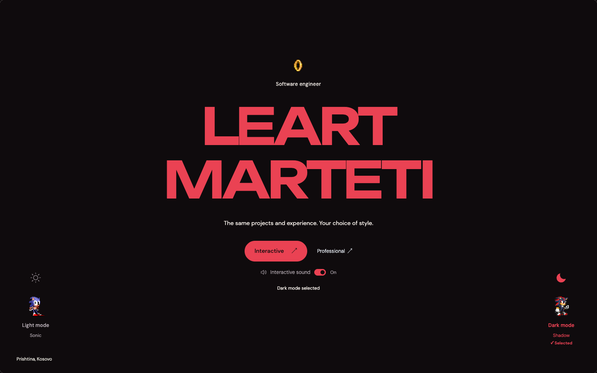
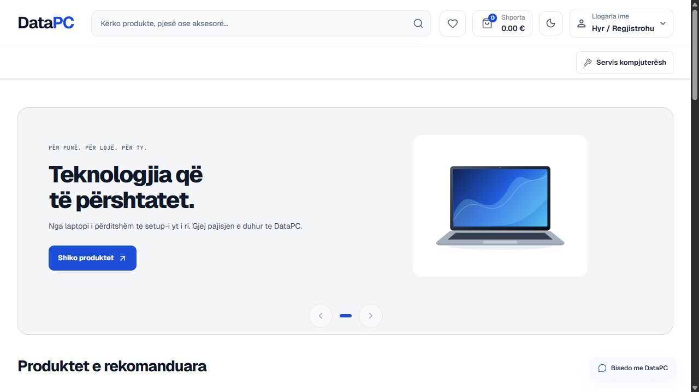
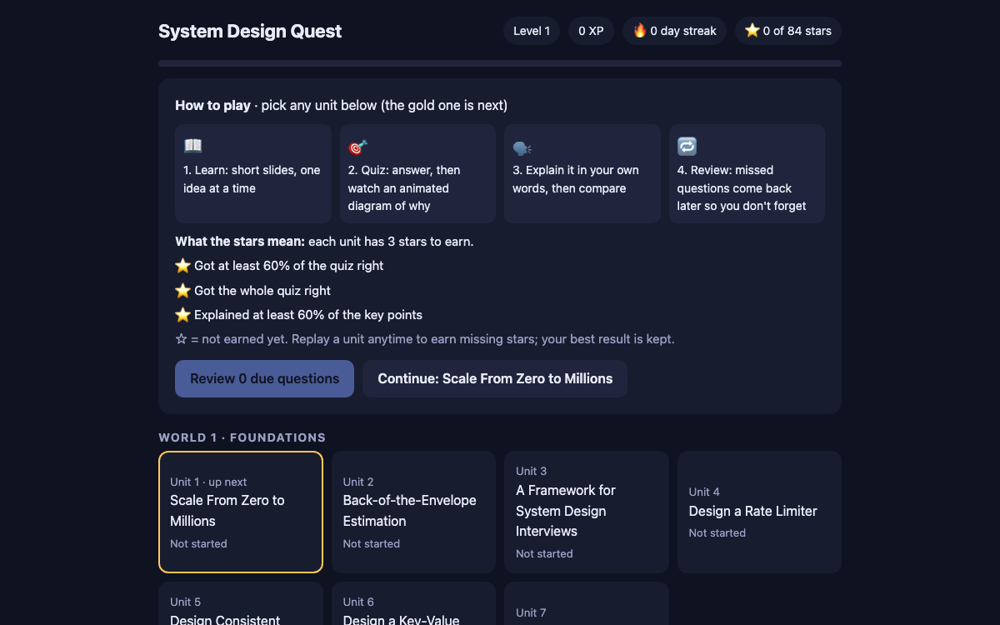

<table>
<tr>
<td width="1000"><b>👋 Hey! I'm Leart</b> — Lead Backend Developer at Behamics, Prishtina, Kosovo</td>
<td align="right">&nbsp;&nbsp;</td>
</tr>
<tr>
<td colspan="2">

</td>
</tr>
<tr>
<td colspan="2">
 
🎮 <b>System Design Quest</b>: learn system design for interviews as a game, with quizzes, animated diagrams and spaced repetition · <a href="https://martetileart.github.io/system-design-quest/">Play</a> · <a href="https://github.com/MartetiLeart/system-design-quest">Code</a>
</td>
</tr>
<tr><td colspan="2">

**languages** 

</td></tr>
<tr><td colspan="2">

**backend** 

</td></tr>
<tr><td colspan="2">

**data** 

</td></tr>
<tr><td colspan="2">

**ai** 

</td></tr>
<tr><td colspan="2">

**frontend** 

</td></tr>
<tr><td colspan="2">

**infra** 

</td></tr>
</table>
